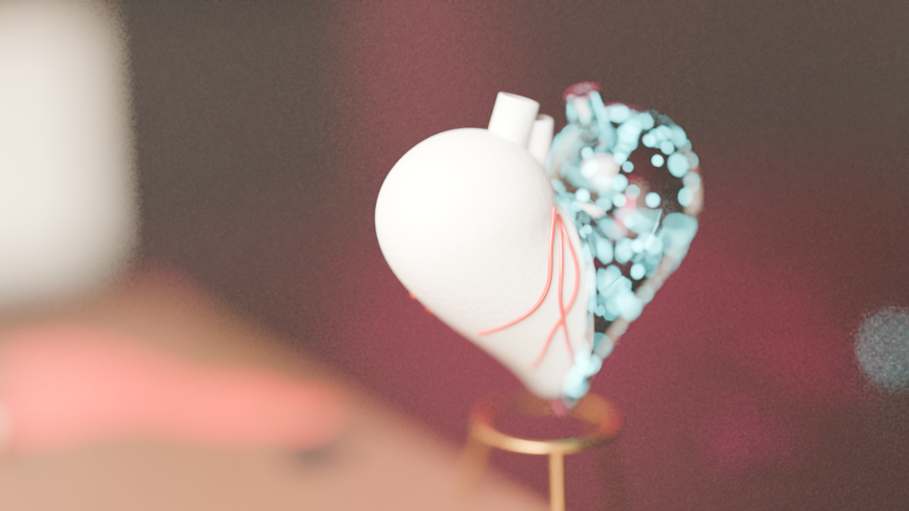

# svc-mv

A music video for a song sung by a [DDSP-SVC](https://github.com/yyren7/DDSP-SVC) voice model, built only in Blender:
small procedural 3D scenes, photographed like 1:12 miniatures and cut into risograph-style zine pages.
Everything is generated by Python scripts; there are no hand-made or AI-generated 3D assets.

The script (in Chinese) is [docs/script_uraomote_v2.md](docs/script_uraomote_v2.md).

| | |
|---|---|
|  |  |
|  |  |

## Scripts

| File | What it does |
|---|---|
| `scripts/mvlib.py` | 2D layout kit: flat / toon / halftone materials, text in Mincho / Gothic / DIN, rules, marks, barcodes |
| `scripts/kit.py` | Blender-native motion kit: F-curve helpers, Geometry Nodes (kinetic text, timecode, bursts, speedlines, shatter), Line Art, rigid bodies, cloth, compositor |
| `scripts/assets.py` | Cycles hero props: the two-faced porcelain / smoked-glass heart, heart bulbs, material library |
| `scripts/s3_workshop.py` | Scene S3, a risograph workshop split into day and night |
| `scripts/styleframes.py` | The two static style frames |
| `scripts/sample.py` | 15-second kinetic sample of the chorus |
| `scripts/test_kit.py` | Smoke test for `kit.py` |
| `scripts/analyze.py` | Beats, downbeats, loudness per frame and sung lines, from the mix and the vocal |
| `scripts/transcribe.py` | Lyrics with word timestamps (faster-whisper) |
| `scripts/encode.py` | Frames + audio slice to MP4, with film grain |

## Setup (Windows)

**Blender 5.2.2 LTS**, portable zip from <https://download.blender.org/release/Blender5.2/>
(or a mirror such as `mirrors.aliyun.com/blender`), unpacked to `D:\tools\blender-5.2.2-windows-x64`.
The scripts use the Blender 5.x API (compositor node groups, action slots, `grease_pencils`) and do not run on 4.x.

**Python tools** (audio analysis, Whisper, ffmpeg via `imageio-ffmpeg`):

```sh
python -m venv .venv
.venv/Scripts/python -m pip install -r requirements.txt
```

**Whisper large-v3** (~2.9 GB, not in the repo), from ModelScope:

```sh
.venv/Scripts/python -m pip install modelscope
.venv/Scripts/python -c "from modelscope import snapshot_download; snapshot_download('pengzhendong/faster-whisper-large-v3', local_dir='models/faster-whisper-large-v3')"
```

**Audio** is not in the repo (the song is copyrighted and the converted voice is not published).
Put your own files in `assets/audio/`: the mix, the separated vocal, and a lines file
(`eval_lines.py`'s `lines.jsonl` from DDSP-SVC, or the output of `transcribe.py`).

## Running

```sh
B=D:/tools/blender-5.2.2-windows-x64/blender.exe
.venv/Scripts/python scripts/analyze.py assets/audio/mix.m4a assets/audio/vocal.wav assets/audio/lines.jsonl assets/audio/timing.json --fps 30
$B -b --factory-startup -P scripts/styleframes.py
SAMPLES=256 $B -b --factory-startup -P scripts/s3_workshop.py   # Cycles, OptiX if available
$B -b --factory-startup -P scripts/test_kit.py
```

Renders go to `renders/`, Blender's temp files to `tmp/`.
Only the style frames and the S3 stills are committed; everything else is rebuilt by the scripts.
