# 裏表ラバーズ: the first experiment

An MV for 《裏表ラバーズ》 (wowaka). Pheebie's cover stands in for the song until the SVC version exists
(181.0 s, about 161 BPM; the cut is on the downbeats, so the SVC version drops into the same grid).
The case tries the whole pipeline end to end: procedural sets in Cycles, illustrations, and an animatic cut on the
downbeats.

- [script_v4.md](script_v4.md): the current script (in Chinese), built on v3. She is a two-sided print: her 表 on
  the front of a thin sheet, her 裏 printed mirrored on the back, showing through when the sheet is lit from behind,
  wet, or seen from behind. The 3D side is one hall hung with these prints over a floor of black water; love is a
  drop of rose ink. Its section map is measured from the song (v3's was off), and hearts, onomatopoeia, everyday
  props and the riso-print illustrations are gone.
- [script_v3.md](script_v3.md): the previous script. 2D and 3D invade each other, on v2.3's six sets.
- [script_v2.md](script_v2.md): v2.3, the six 3D sets S1–S6. v4 no longer uses them.
- [CREDITS.md](CREDITS.md): the CC BY assets in the v3 sets. A video that shows them must carry these lines.

## v3: the six sets, as stills (v4 no longer uses them)

| | |
|---|---|
| S1 bedroom, 6:59 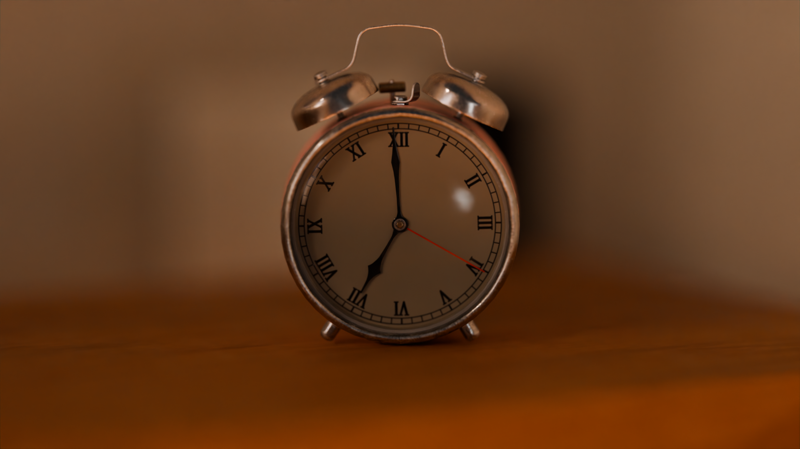 | S1 the set box 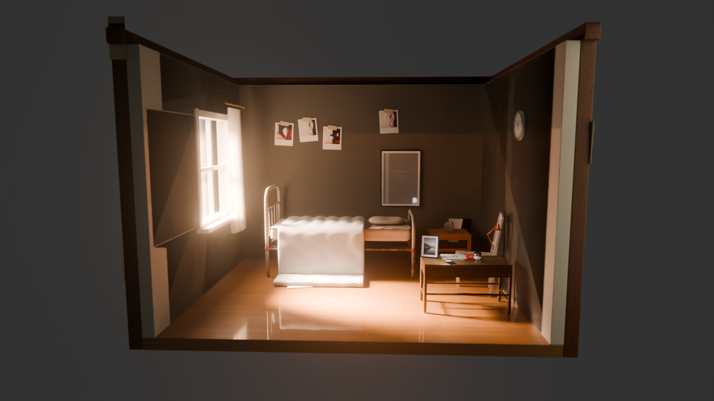 |
| S1 from the pillow 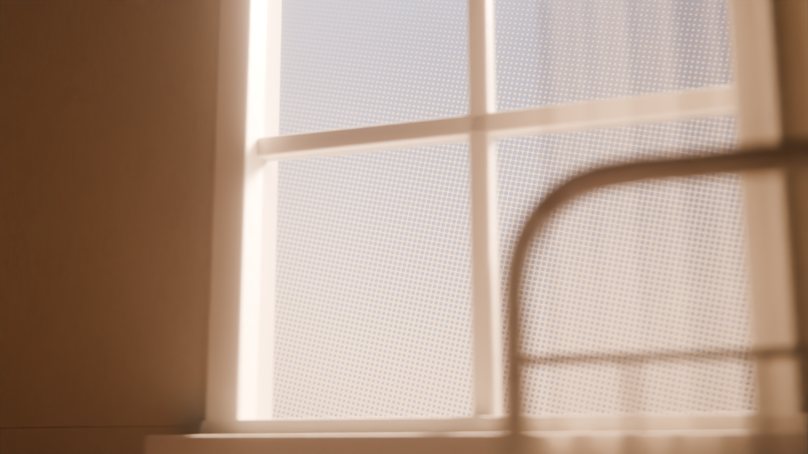 | S2 the bell jar 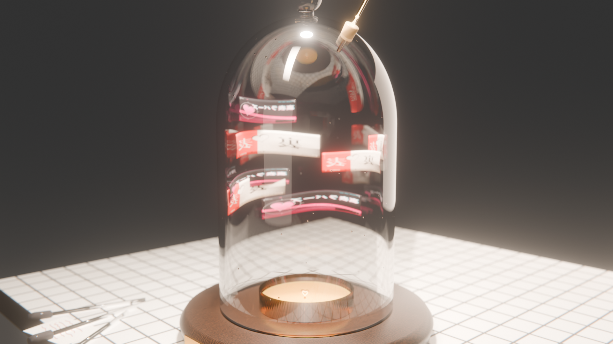 |
| S2 the first heart on the agar  | S3 the workshop, day and night 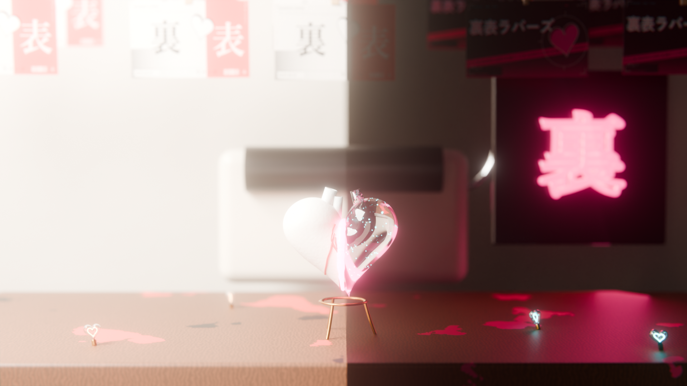 |
| S3 the resin seam 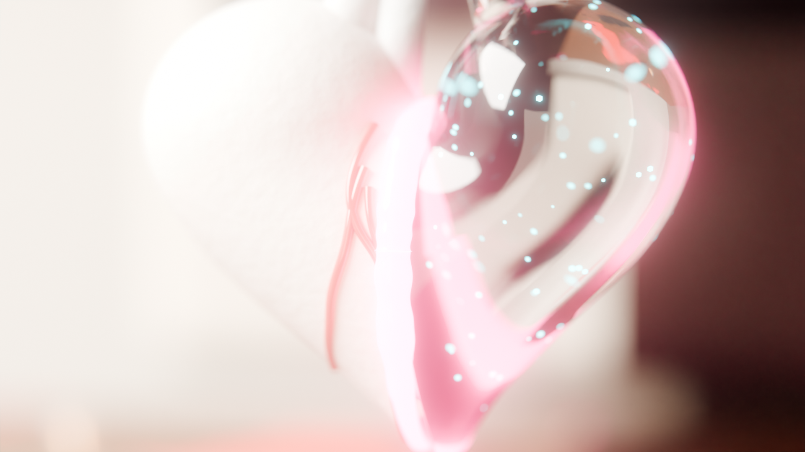 | S4 the phone booth 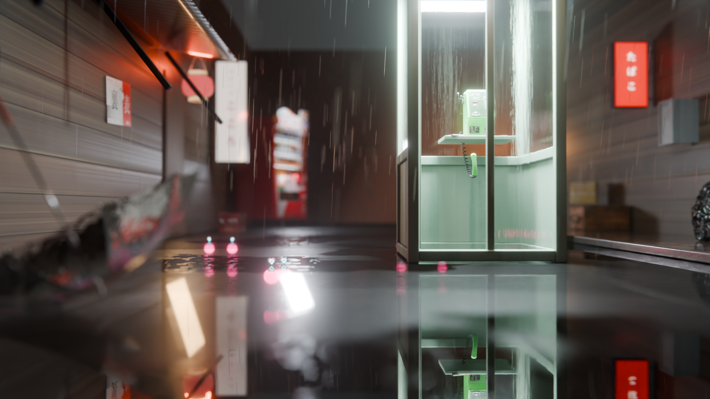 |
| S4 the handset 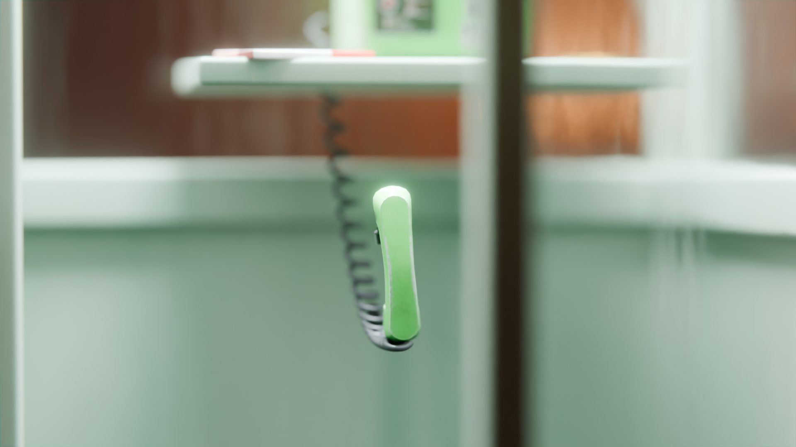 | S5 the platform at sunset 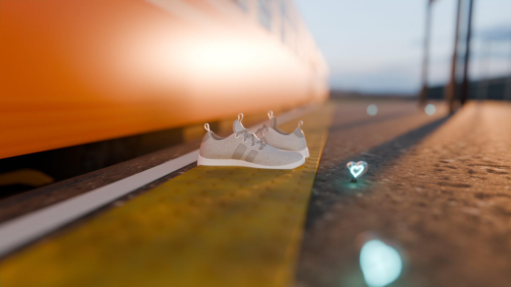 |
| S5 the same platform at night 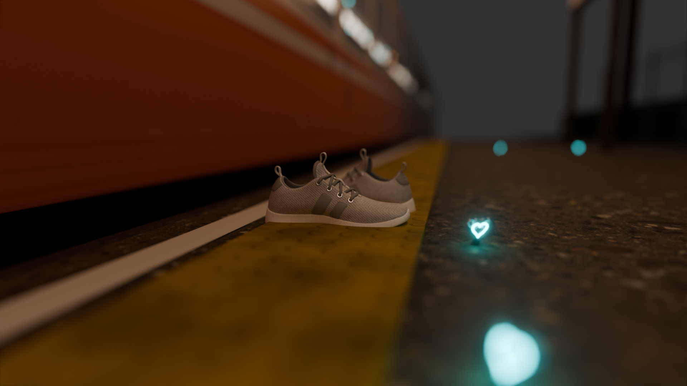 | S5 her shoes 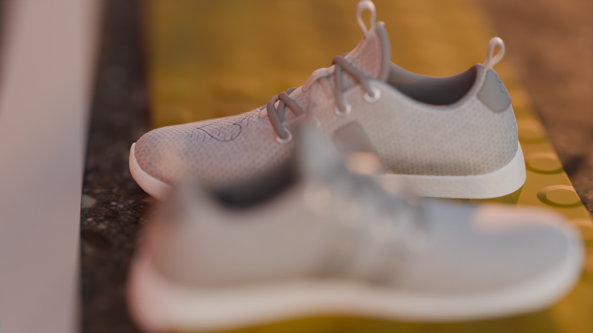 |
| S6 the bedroom, inverted 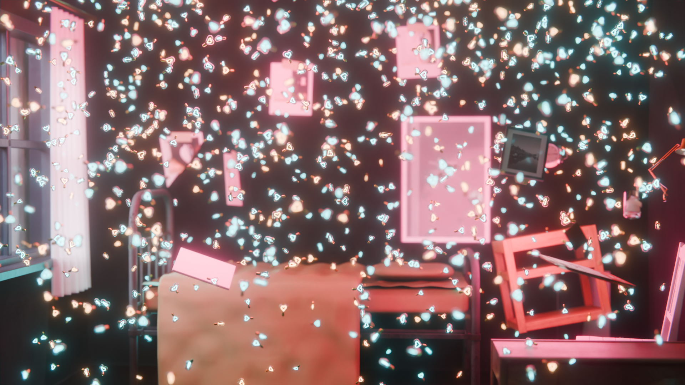 | S6 the clock falling up 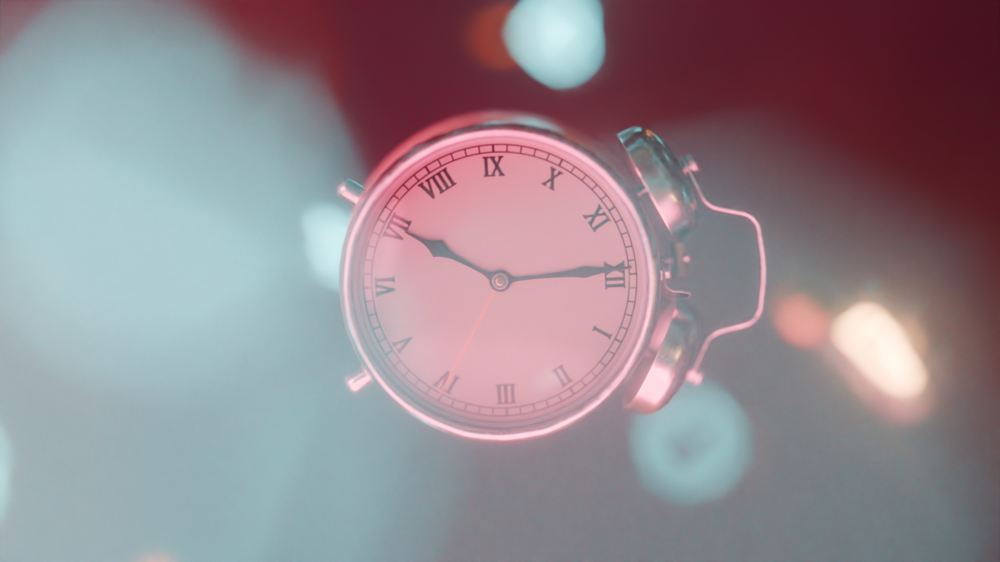 |

Style frames (the 2D side):  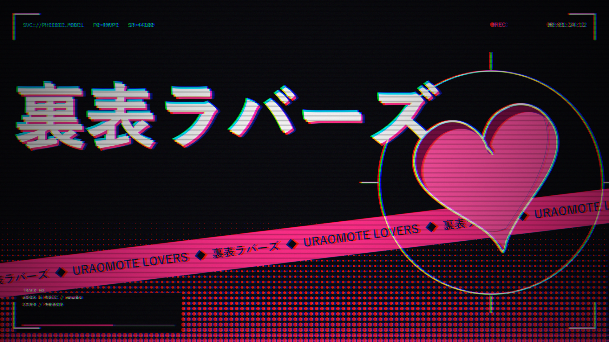

## Scripts

| File | What it does |
|---|---|
| `scripts/case.py` | This case's folders; puts the pipeline's `scripts/` on `sys.path` |
| `scripts/s1_bedroom.py` | S1 the bedroom at 6:59 (also builds S6's inverted room in the 裏 palette) |
| `scripts/s2_belljar.py` | S2 the bell jar on the lab bench |
| `scripts/s3_workshop.py` | S3 the risograph workshop split into day and night |
| `scripts/s4_booth.py` | S4 the phone booth in the rain |
| `scripts/s5_platform.py` | S5 the platform, sunset and night |
| `scripts/s6_inverted.py` | S6 the bedroom upside down, the furniture falling up |
| `scripts/styleframes.py` | The two static style frames |
| `scripts/sample.py` | 15-second kinetic sample of the chorus |
| `scripts/animatic.py` | The whole PV at low resolution: every set's shots moving to the song, cut on the downbeats |
| `scripts/animatic_cut.py` | Joins the animatic's frames with the song into an MP4 |
| `scripts/v4_hall.py` | v4: the hall's look, stills at dawn and in rose light, the prints carrying the v4 pictures. Written, not run yet |

The sets show each other's pictures as prints: S1's polaroids are the S3 stills, and the style frames hang in
S1, S2, S3, S4 and S5. Render the style frames and S3 before the others.

## Running

From the repository root. `audio/` holds `urao_mix.m4a`, `urao_vocal.wav`, `urao_lines.jsonl` (not in git).

```sh
B=D:/tools/blender-5.2.2-windows-x64/blender.exe
C=cases/uraomote
.venv/Scripts/python scripts/analyze.py $C/audio/urao_mix.m4a $C/audio/urao_vocal.wav $C/audio/urao_lines.jsonl $C/audio/urao_timing.json --fps 30
$B -b --factory-startup -P $C/scripts/styleframes.py -- A $C/renders/frame_A.png
$B -b --factory-startup -P $C/scripts/styleframes.py -- B $C/renders/frame_B.png
SAMPLES=256 $B -b --factory-startup -P $C/scripts/s3_workshop.py     # writes $C/renders/s3/
RES=40 SAMPLES=24 $B -b --factory-startup -P $C/scripts/s1_bedroom.py -- tmp/s1 wide   # quick look at 40 %
FPS=12 SAMPLES=24 WIDTH=640 $B -b --factory-startup -P $C/scripts/animatic.py -- s3 $C/renders/animatic/full
.venv/Scripts/python $C/scripts/animatic_cut.py $C/renders/animatic/full $C/audio/urao_mix.m4a $C/renders/animatic/animatic.mp4 12
```

The animatic's parts are `title s1 s2 s3 s4 s5_omote s5_ura s6`. They can run side by side into the same folder.

## Illustrations

Her illustrations are drawn on ComfyUI as in [docs/comfyui.md](../../docs/comfyui.md). The pictures stay off git,
in `art/` on the local disk and in the server's checkout, with contact sheets `art/**/_sheet_*.png`.

### v4

Script v4, section 3.4, on Qwen-Image-2.1 (小铃久绘's recipe). `jobs/v4_prompts.py` holds what every round shares:
her design, the look, the 表 and 裏 lights. Pictures in `art/v4/`.

| Jobs | Pictures | |
|---|---|---|
| `jobs/v4_t1.json` (from `v4_t1.py`) | `v4_{sheet,kv,window,chorus,water,rain,print}_*` | Her new design and the look, no reference. `sheet_201` is the design; the 表 pictures (kv, window) work, the 裏 ones came out flat: one pink light, blank faces, pink smoke for ink, ink tears that read as blood, and the bird's-eye view ignored |
| `jobs/v4_t2.json` (from `v4_t2.py`) | `v4_{kv,a1–a5,q1,c1–c4,w1,w2,u1,u2,u4,r0,f1,f2}_211/213`, `v4_s1–s3_211` | Every illustration of 3.4 from `sheet_201`, two seeds each, and the three skies. The 裏 light gained a cold fill and every face its expression. Sheet: `_sheet_v4_t2.png`. Not picked yet; KV' and Q2 come from the picks |

### v3 (no longer used)

| Jobs | Pictures | |
|---|---|---|
| `jobs/t1.json` | `t_anima_*`, `t_qwen_*` | Anima and Qwen on one prompt. Anima's flat print look won; every later round is Anima |
| `jobs/t2.json`, `t3.json` | `kv_*`, `ura_*`, `back*`, `legs_*`, `hand*`, `eye*` | The key visual, its 裏 version, her back, the running legs, the hand and the eye, several seeds each. The kv drafts are all front views in the middle of a portrait frame; no ura draft shares a kv draft's composition |
| `jobs/t4.json` (from `t4.py`) | `kvu_*` | KV' in a KV candidate's own composition: kv_43, kv_47 and kv_53 with the cream ground flooded black, redrawn at 0.6 (only the face changes) and 0.75 (the hair lifts, the heart turns fluorescent) |

Every kv draft has the patch on her right elbow; the design says left.
